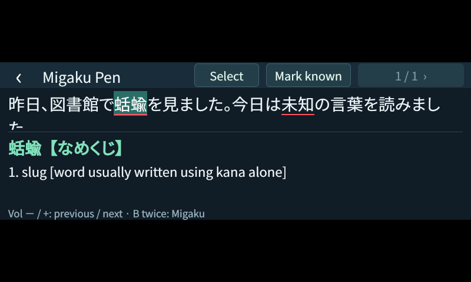

# TranslatePen

Japanese dictionary lookup and optional Migaku integration for the **WorldPenScan Go MSE09**. Scan a line in a physical book, navigate whole words with the volume keys, and read definitions and name readings on the pen. Double-press B to send the sentence and selected word to Migaku.



**Developer preview.** This works on the author's device running application **V2.2.83**. The native bridge and launcher patch require an exact executable checksum. Other firmware versions are unsupported. Installation is currently manual; a complete power-cycle and restore/reinstall sequence has not yet been validated.

## What it does

- Looks up compounds and conjugated forms using local JMdict data and Yomichan deinflection.
- Provides offline JMnedict readings for names, places and stations, with alternative readings.
- Offers taps, manual span selection and volume-key navigation.
- Sends scans to a Japanese OCR service on your computer or home server. OCR needs a working LAN connection; dictionary lookup is local.
- With [Migaku Local API](https://github.com/fdansv/migaku-api), underlines unknown words, marks words known, and queues sentence cards without blocking dictionary lookup.

Migaku features require your own account and an authenticated Migaku extension running on the API host. Migaku synchronization and AI enrichment use Migaku's online services. Local OCR needs no internet after model download.

## Start here

1. Read the [combined setup guide](docs/setup.md), including firmware and SSH prerequisites.
2. Set up [dictionary data and server OCR](docs/ocr.md).
3. Review [development and testing](docs/development.md) before building or changing the native plugin.

This source release contains the app, native bridge, patcher, dictionary builders, CPU OCR and optional GPU corroborator. It does **not** contain PenPower firmware, extracted vendor resources, account sessions, model weights or compiled installation bundles.

## Controls

| Action | Control |
| --- | --- |
| Scan text | Scan tip / scan key |
| Next / previous word | Volume + / −; wraps at either end |
| Choose a word | Tap it |
| Select an exact span | Select, then tap the first and last character |
| Next dictionary alternative | **1 / N ›** |
| Mark a word known | **Mark known**; needs Migaku API |
| Create a Migaku sentence card | B twice within 450 ms |
| Return to the stock interface | Back arrow or circular hardware key |

## How it fits together

```text
Pen scanner → native Qt bridge → LAN OCR service → sentence on pen
                                                    ↓
                                            local dictionary
                                                    ↓
                               optional Migaku Local API → Migaku
```

The plugin runs inside the existing Qt application. The launcher patch adds the new page and reserves volume-key navigation for it. No partitions are flashed and vendor startup/watchdog scripts are retained. [Architecture and compatibility](docs/architecture.md).

## Status and limits

The existing device has passed physical scan checks, dictionary/navigation checks and Migaku integration checks. Those results describe one MSE09 and the author's server; they are not a multi-device compatibility claim. OCR still makes mistakes, particularly with furigana, clipped scans and ambiguous glyphs. Battery impact and broad font/layout coverage have not been established.

The CPU OCR pipeline is the baseline. An optional GPU corroborator improved saved cases and a small number of fresh scans, but adds hardware/model requirements. See [OCR setup](docs/ocr.md). This release has no one-click installer or prebuilt native plugin; the complete toolchain bootstrap is still a packaging task.

## Contributing

See [CONTRIBUTING.md](CONTRIBUTING.md). Contributions toward installation, compatible firmware versions, OCR fixtures and additional destinations such as Anki are welcome. Keep local lookup independent of remote services.

## License and attribution

TranslatePen code is **GPL-3.0-or-later**; see [LICENSE](LICENSE). The deinflection algorithm and rules are adapted from Yomichan and retain its notices. Derived JMdict/JMnedict dictionary data is **CC BY-SA 4.0**, separately from the code. See [NOTICE](NOTICE) and [vendor/ATTRIBUTION.txt](vendor/ATTRIBUTION.txt).

This is an independent project, unaffiliated with PenPower or Migaku. Vendor firmware, fonts, dictionaries and the Migaku extension retain their own ownership and licensing.
